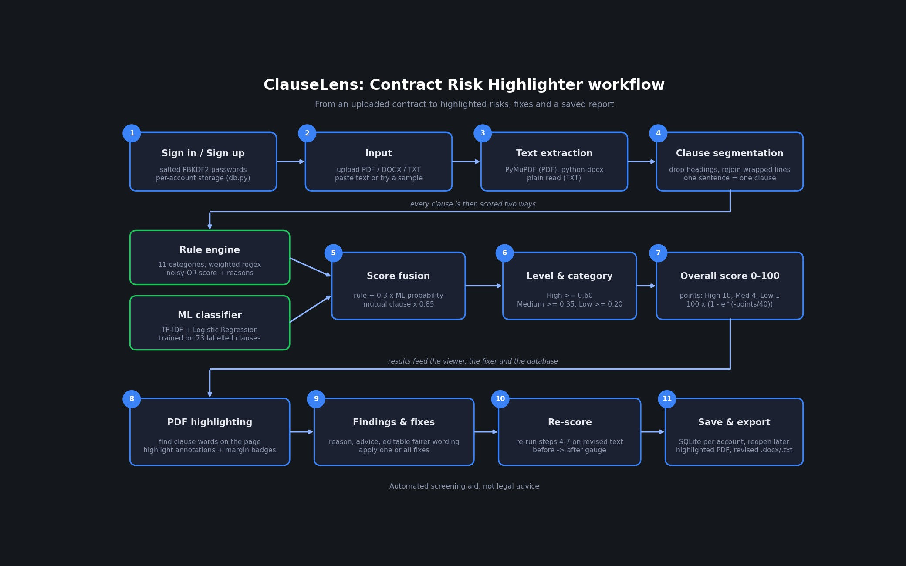

# ClauseLens: Contract Risk Highlighter

An NLP system that reads a contract (PDF, DOCX, TXT or pasted text), finds risky clauses, classifies each
by **risk type**, assigns a **risk level** (High / Medium / Low), explains **why** it was flagged, highlights it
**directly on the original PDF**, and lets you **fix it** with fairer wording, then re-scores the contract.

**Problem it solves:** contracts are long and hard to read, and clauses on liability, payments, termination,
confidentiality or auto-renewal can cost money or create legal exposure. Manual review needs expertise and time.
ClauseLens screens a contract in seconds and shows where to look and what to ask for instead.

> Automated screening aid, **not legal advice**.

---

## Features

| Feature | What it does |
|---|---|
| Risk detection | 11 risk categories, 3 severity levels, plain-English reason for every flag |
| PDF highlighting | Highlights drawn on the real PDF pages, with numbered margin badges and a downloadable highlighted PDF |
| Overall risk score | 0-100 score from severity points, shown on an animated gauge |
| Heat-strip | One block per clause in document order, so you see where the danger sits |
| One-click fixes | Editable fairer wording per finding, **Apply all fixes**, before/after score, download revised `.docx` / `.txt` |
| Accounts | Sign up / sign in; every analysed document is saved per account and can be reopened or deleted |
| Dark UI | Dark grey + dark blue Streamlit interface |

---

## How it works (step by step)



(regenerate the diagram with `python make_workflow.py`)

```
 Sign in
    |
    v
 1. Input ........ upload PDF / DOCX / TXT, paste text, or pick a sample
    |
    v
 2. Text extraction  (PyMuPDF for PDF, python-docx for DOCX, plain read for TXT)
    |
    v
 3. Clause segmentation  (headings removed, one sentence ~ one clause)
    |
    v
 4. Per-clause scoring  -----------------+--> 4a. Rule engine (weighted regex, 11 categories)
    |                                    +--> 4b. ML classifier (TF-IDF + Logistic Regression)
    v                                         fused into one score per category
 5. Level + category  (best category wins, score -> High / Medium / Low)
    |
    v
 6. Overall contract score  (severity points -> 0-100)
    |
    +--> 7. PDF highlighting (find each clause's words on the page, draw highlights)
    +--> 8. Fix & re-score   (swap in fairer wording, run steps 3-6 again)
    +--> 9. Save to your account (SQLite) so you can reopen it later
```

### 1. Input and accounts
`app.py` shows a sign-in / create-account screen first. `db.py` stores users in SQLite
(`data/app.db`). Passwords are **never stored**: each one is salted (random 16 bytes) and hashed with
PBKDF2-SHA256 (200,000 iterations), and compared in constant time. After sign-in you can upload a file,
paste text, or try one of the two sample contracts. Each account only ever sees its own documents.

### 2. Text extraction
- **PDF:** PyMuPDF (`risk_engine/pdf_view.py::extract_text`) reads the text of every page. Scanned
  (image-only) PDFs contain no text and need OCR first; the app says so.
- **DOCX:** `python-docx` joins the paragraphs.
- **TXT / pasted:** read as UTF-8.
Text is capped at 200,000 characters.

### 3. Clause segmentation (`risk_engine/segmenter.py`)
Contracts are split into clause-sized units so each obligation is scored on its own:
1. Normalise whitespace and line endings.
2. Drop **heading** lines such as `3. Termination` or `LIABILITY` (short, no final punctuation, ALL CAPS or
   Title Case). A real short clause like `Fees are non-refundable` is kept.
3. Join hard-wrapped lines (common in PDFs) until a blank line or a new numbered item starts a block.
4. Strip the leading `1.` / `(a)` numbering and split each block into **sentences**.
5. Merge fragments shorter than 25 characters into the previous clause.

### 4. Hybrid scoring (`rules.py`, `classifier.py`, `analyzer.py`)

**4a. Rule engine (drives the score and the explanation).** `rules.py` holds 11 risk categories. Each has
weighted regular-expression rules with a human-readable reason, plus an optional *gate* (the clause must
mention a related word, so "perpetual" only counts as confidentiality risk if the clause is about
confidentiality). The matched weights are combined with a **noisy-OR**:

```
rule_score = 1 - (1 - w1) x (1 - w2) x ...
```
so several independent red flags push the score up, but never past 1.

| Category | Typical triggers |
|---|---|
| Liability & Indemnification | unlimited/uncapped liability, hold harmless, sole responsibility, penalties |
| Payment Terms | non-refundable, high late fees, very short payment window, unilateral price changes |
| Termination | terminate without notice, cannot terminate, termination fees |
| Auto-Renewal | automatically renews, successive terms, long opt-out notice |
| Confidentiality | "any and all information", no end date, injunctive relief, penalties |
| Intellectual Property | assigns all rights, irrevocable/perpetual licence, work for hire |
| Non-Compete & Exclusivity | non-compete, exclusivity, non-solicitation |
| Dispute Resolution | binding arbitration, waiver of jury / class action, exclusive jurisdiction |
| Warranty Disclaimer | "as is", disclaims all warranties, no responsibility for defects |
| Unilateral Changes | modify at any time without notice, sole discretion, assign without consent |
| Data Privacy | sell/share data with third parties, no responsibility for breaches, indefinite retention |

**4b. ML classifier.** A scikit-learn pipeline (word 1-2-gram TF-IDF + character 3-5-gram TF-IDF ->
Logistic Regression) is trained on `data/seed_clauses.csv` (73 labelled clauses, 11 risk classes + `None`).
It returns a probability for every category. It is trained automatically on first run (or with
`python train.py`) and saved to `model/`.

**4c. Fusion.** For each category:
- If a rule fired: `final = 1 - (1 - rule_score) x (1 - 0.30 x p_ml)`. The model nudges the score up when it agrees.
- If no rule fired but the model is at least 70% sure: a low "ML suggestion" score is used (shown as source `ml`).
- If the clause is mutual ("either party", "each party"), the score is multiplied by 0.85.

### 5. Category and level
The category with the highest score becomes the clause's category (others are kept as "also touches").
The score maps to a level: **High >= 0.60**, **Medium >= 0.35**, **Low >= 0.20**; below that the clause
is not flagged.

**Worked example.** `The Provider may terminate this Agreement immediately and without notice in its sole
discretion.` -> Termination rules match "without notice" (0.55) and "sole discretion" (0.50):
`1 - 0.45 x 0.50 = 0.775`, the model agrees, final about 0.83 -> **High, Termination**.

### 6. Overall contract score
Each flagged clause is worth severity points: High = 10, Medium = 4, Low = 1. The total is squashed so the
score rises quickly at first and saturates smoothly instead of hitting 100 on any long contract:

```
overall = 100 x (1 - e^(-points / 40))        Low < 30  <=  Medium < 60  <=  High
```
Sample results: the fair consulting agreement scores **7 (Low)**; the risky SaaS contract scores **98 (High)**.

### 7. Highlighting on the PDF (`risk_engine/pdf_view.py`)
1. Read every word on every page with its coordinates.
2. For each clause, find its words in that word stream (matching the first few words, searching forward
   from the previous match, so it stays fast and handles line wraps).
3. Merge the words into one rectangle per text line and add a real PDF **highlight annotation**
   (red = High, amber = Medium, green = Low) carrying the reason as its note.
4. Draw a small numbered badge in the margin; the number matches *clause N* in the findings list, and each
   finding shows its page.
5. Render the pages to images for the app and keep the annotated PDF for download.
For DOCX/TXT/pasted text the same highlights are shown over the text instead.

### 8. Fixing (`risk_engine/fixer.py`)
Every finding comes with **fairer replacement wording** for its category (for example a liability cap tied to
12 months of fees, 30-day payment terms, mutual 30-day termination). You can edit it, tick **Apply this fix**
(or **Apply all fixes**), and the app swaps each chosen clause in the original text. The swap matches the clause
token by token, so line wraps don't matter. The revised text is analysed again and a **before -> after**
gauge shows the new score (the risky sample goes from 98 to 2 after all fixes). Download it as `.docx` or `.txt`.
A PDF can't be edited in place, so the revised contract is a Word file built from the PDF's text.

### 9. Saving and reopening
Each analysis (text, scores, and the original PDF) is saved in SQLite under your account. **My documents**
lists them with their score; **Open** re-runs the analysis and redraws the PDF highlights, **Delete** removes it.

---

## Run locally

```bash
python -m venv .venv
.venv\Scripts\activate          # Windows (use source .venv/bin/activate on Mac/Linux)
pip install -r requirements.txt
streamlit run app.py            # open http://localhost:8501
```

```bash
python train.py                 # optional: retrain the classifier + print cross-validated accuracy
python -m pytest                # run the 13 tests
```
Create an account on the first screen, then try **Try a sample**, or upload `samples/sample_contract.pdf`.

## Deploy

**Streamlit Community Cloud (free):** push the repo to GitHub -> https://share.streamlit.io -> New app ->
repo, branch `main`, main file `app.py`.
Accounts and saved documents are wiped when the app restarts there.

**Docker (Railway, Render, Fly.io...):**
```bash
docker build -t clauselens .
docker run -p 8501:8501 -v clauselens-data:/data -e DATA_DIR=/data clauselens
```
Point `DATA_DIR` at a persistent volume to keep accounts and documents. The container honours `$PORT`.

## Project layout

```
app.py                    Streamlit UI (login, dashboard, PDF view, findings, fixes)
db.py                     SQLite accounts + saved analyses (PBKDF2 password hashing)
train.py                  trains the classifier, prints cross-validated accuracy
risk_engine/
  segmenter.py            text -> clauses
  rules.py                11 risk categories, weighted regex rules, advice, fairer wording
  classifier.py           TF-IDF + Logistic Regression
  analyzer.py             fusion, levels, overall score, report objects
  pdf_view.py             PDF text extraction + highlight annotations
  fixer.py                applies replacement wording to the original text
data/seed_clauses.csv     labelled training clauses
samples/                  risky + fair sample contracts (txt, pdf)
tests/                    13 pytest tests
Dockerfile, .streamlit/   deployment and theme config
```

## Tech stack
Python, Streamlit, scikit-learn (TF-IDF, Logistic Regression), regex rule engine, PyMuPDF, python-docx,
SQLite, pytest, Docker.

## Limitations
- The classifier's cross-validated accuracy on the 73-clause seed set is about **48%** over 12 classes, so it is
  a supporting signal; precision comes mainly from the rules. Adding labelled clauses (for example the CUAD
  dataset) to `data/seed_clauses.csv` and re-running `train.py` is the main upgrade path.
- English only; scanned PDFs need OCR first; rules can miss unusual wording or over-flag harmless wording.
- Contract text is stored **unencrypted** in SQLite, so don't host publicly for confidential documents without
  adding encryption. There is no login rate-limiting or password reset.
- PyMuPDF is AGPL-licensed; check that is acceptable before publishing the app commercially.
- Not legal advice. Have a lawyer review contracts before signing.
